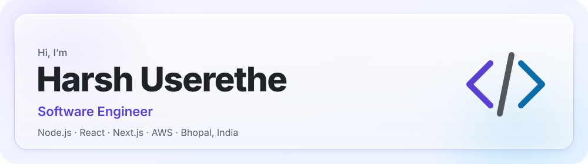
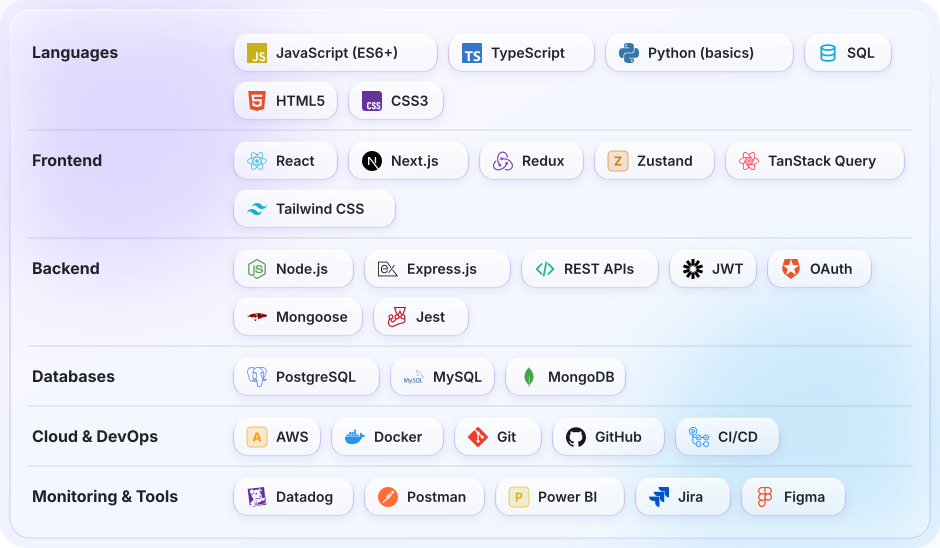

<picture>
  <source media="(prefers-color-scheme: dark)" srcset="assets/hero-dark.svg">
  <source media="(prefers-color-scheme: light)" srcset="assets/hero-light.svg">
  
</picture>

 

<a href="https://linkedin.com/in/harshuserethe"><picture><source media="(prefers-color-scheme: dark)" srcset="assets/social-linkedin-dark.svg"><source media="(prefers-color-scheme: light)" srcset="assets/social-linkedin-light.svg"></picture></a>
<a href="https://github.com/HarshUserethe"><picture><source media="(prefers-color-scheme: dark)" srcset="assets/social-github-dark.svg"><source media="(prefers-color-scheme: light)" srcset="assets/social-github-light.svg"></picture></a>
<a href="https://x.com/HarshUserethe04"><picture><source media="(prefers-color-scheme: dark)" srcset="assets/social-x-dark.svg"><source media="(prefers-color-scheme: light)" srcset="assets/social-x-light.svg"></picture></a>
<a href="https://instagram.com/harshuserethe"><picture><source media="(prefers-color-scheme: dark)" srcset="assets/social-instagram-dark.svg"><source media="(prefers-color-scheme: light)" srcset="assets/social-instagram-light.svg"></picture></a>
<a href="mailto:useretheharsh@gmail.com"><picture><source media="(prefers-color-scheme: dark)" srcset="assets/social-email-dark.svg"><source media="(prefers-color-scheme: light)" srcset="assets/social-email-light.svg"></picture></a>

---

## About

Software engineer with 2+ years of experience building and maintaining web services and REST APIs in JavaScript and TypeScript, with working knowledge of Python. Comfortable with SQL and NoSQL databases, AWS, Docker and CI/CD, and used to tracing production issues through logs and stack traces.

Day to day I build features, trace production bugs through error logs and stack traces, design REST APIs, and work across both SQL and NoSQL databases. Recent highlights include building a notification centre with category filtering, pagination and read/unread tracking, and integrating an LLM-powered HR assistant with AI-based resume parsing and job description generation into a multi-tenant HRMS platform.

I'm equally comfortable converting Figma designs into pixel-accurate UIs, writing and profiling backend services, and monitoring live systems with Datadog, Catchpoint and Akamai. I coordinate closely with QA and business teams to ship on schedule.

Looking to move toward cloud and backend-heavy product engineering, where ownership of a feature from design to deployment is expected.

---

## Education

🎓 **B.Tech, Computer Science & Engineering**
Sagar Institute of Research and Technology, Bhopal
Jun 2020 – Jun 2024 · **CGPA: 8.13 / 10**

---

## Experience

### Software Engineer — Java R&D Pvt. Ltd.
Oct 2025 – Present · Bhopal

- Resolved production defects in a React / Next.js application by working through error logs and stack traces, delivering fixes without regressions.
- Built a notification centre with category filters, pagination and read/unread tracking after confirming requirements with the BA team.
- Developed Node.js REST APIs on SQL databases and wrote Jest tests for each fix and feature, keeping releases stable through the Git/GitHub CI/CD pipeline.
- Monitored site performance with Datadog, Catchpoint and Akamai and collaborated with QA and business teams to hit release dates.

---

## Skills

<picture>
  <source media="(prefers-color-scheme: dark)" srcset="assets/skills-dark.svg">
  <source media="(prefers-color-scheme: light)" srcset="assets/skills-light.svg">
  
</picture>

---

## GitHub Statistics

> Stats are pulled live from public GitHub data. Private repository activity may not be reflected.

<picture>
  <source media="(prefers-color-scheme: dark)" srcset="https://github-readme-stats.vercel.app/api?username=HarshUserethe&show_icons=true&theme=transparent&hide_border=true&title_color=B6A4FF&icon_color=7CC7FF&text_color=F0F6FC">
  <source media="(prefers-color-scheme: light)" srcset="https://github-readme-stats.vercel.app/api?username=HarshUserethe&show_icons=true&theme=transparent&hide_border=true&title_color=5B3FD0&icon_color=0A6CA8&text_color=1F2328">
  
</picture>
&nbsp;&nbsp;
<picture>
  <source media="(prefers-color-scheme: dark)" srcset="https://github-readme-stats.vercel.app/api/top-langs/?username=HarshUserethe&layout=compact&theme=transparent&hide_border=true&title_color=B6A4FF&text_color=F0F6FC">
  <source media="(prefers-color-scheme: light)" srcset="https://github-readme-stats.vercel.app/api/top-langs/?username=HarshUserethe&layout=compact&theme=transparent&hide_border=true&title_color=5B3FD0&text_color=1F2328">
  
</picture>

<picture>
  <source media="(prefers-color-scheme: dark)" srcset="https://streak-stats.demolab.com/?user=HarshUserethe&theme=transparent&hide_border=true&ring=B6A4FF&fire=FF7AA8&currStreakNum=F0F6FC&sideNums=F0F6FC&currStreakLabel=B6A4FF&sideLabels=B4BFCC&dates=B4BFCC">
  <source media="(prefers-color-scheme: light)" srcset="https://streak-stats.demolab.com/?user=HarshUserethe&theme=transparent&hide_border=true&ring=5B3FD0&fire=D6336C&currStreakNum=1F2328&sideNums=1F2328&currStreakLabel=5B3FD0&sideLabels=57606A&dates=57606A">
  
</picture>

---

## Contribution Activity

<picture>
  <source media="(prefers-color-scheme: dark)" srcset="https://github-readme-activity-graph.vercel.app/graph?username=HarshUserethe&bg_color=0D1117&color=B6A4FF&line=7C5CFF&point=F0F6FC&area=true&area_color=7C5CFF&hide_border=true">
  <source media="(prefers-color-scheme: light)" srcset="https://github-readme-activity-graph.vercel.app/graph?username=HarshUserethe&bg_color=FFFFFF&color=5B3FD0&line=5B3FD0&point=1F2328&area=true&area_color=8B6CFF&hide_border=true">
  
</picture>

---

<picture>
  <source media="(prefers-color-scheme: dark)" srcset="assets/footer-dark.svg">
  <source media="(prefers-color-scheme: light)" srcset="assets/footer-light.svg">
  
</picture>

 

<a href="https://github.com/HarshUserethe">
  <picture>
    <source media="(prefers-color-scheme: dark)" srcset="https://komarev.com/ghpvc/?username=HarshUserethe&color=7C5CFF&style=flat-square&label=Profile+Views">
    <source media="(prefers-color-scheme: light)" srcset="https://komarev.com/ghpvc/?username=HarshUserethe&color=5B3FD0&style=flat-square&label=Profile+Views">
    
  </picture>
</a>

